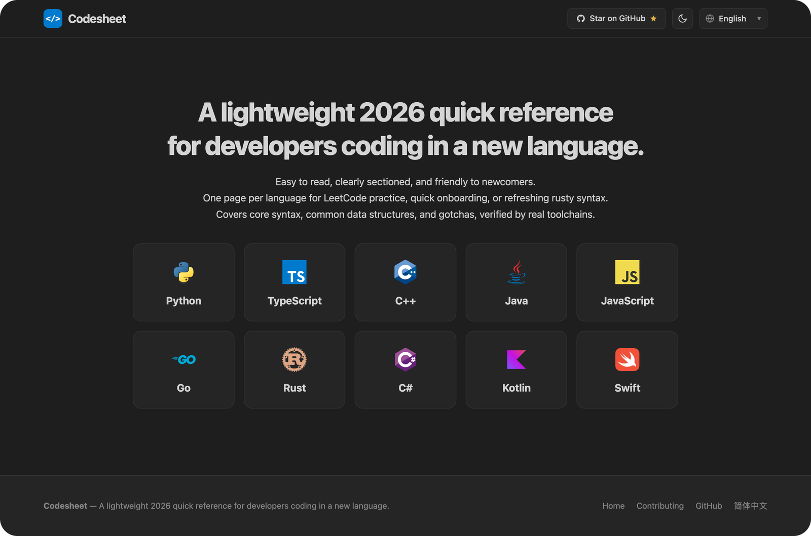

<div align="center">


# Codesheet

**The 2026 quick reference for developers coding in a new language.**

One page per language for LeetCode practice, quick onboarding, or refreshing rusty syntax.<br>

[](https://github.com/Kepler2024/Codesheet/actions/workflows/check.yml)
[](#the-sheets)
[](#why-codesheet)
[](CONTRIBUTING.md)
[](https://github.com/Kepler2024/Codesheet/stargazers)

<a href="sheets/python.md"></a>&nbsp;
<a href="sheets/java.md"></a>&nbsp;
<a href="sheets/cpp.md"></a>&nbsp;
<a href="sheets/javascript.md"></a>&nbsp;
<a href="sheets/typescript.md"></a>&nbsp;
<a href="sheets/csharp.md"></a>&nbsp;
<a href="sheets/go.md"></a>&nbsp;
<a href="sheets/kotlin.md"></a>&nbsp;
<a href="sheets/swift.md"></a>&nbsp;
<a href="sheets/rust.md"></a>

<p align="center">
  <a href="https://codesheet.io/"></a>
</p>

**[Read online](https://codesheet.io/)** · [Browse the sheets](#the-sheets) · [Contribute](CONTRIBUTING.md)

**English** | [简体中文](README.zh-CN.md)

</div>

---

## Guess the output

Five snippets in five languages, all taken from the sheets. How many can you get right?

| Language | Code |
|---|---|
| JavaScript | `console.log([10, 9, 1].sort())` |
| Java | `Integer a = 127, b = 127;`<br>`Integer c = 1000, d = 1000;`<br>`System.out.println((a == b) + " " + (c == d));` |
| C++ | `vector<int> empty;`<br>`cout << empty.size() - 1 << endl;` |
| Kotlin | `println('a' + 1)` |
| Python | `bad = [[0] * 4] * 3`<br>`bad[0][0] = 1`<br>`print(bad)` |

<details>
<summary><b>Show the answers</b></summary>
<br>

| Language | Prints | Why |
|---|---|---|
| JavaScript | `[ 1, 10, 9 ]` | Without a comparator, `sort()` compares numbers as strings. [Arrays →](sheets/javascript.md#arrays) |
| Java | `true false` | `==` on two `Integer`s compares references. It only seems to work from -128 to 127, because those values are cached. [Primitive and Boxed Types →](sheets/java.md#primitive-and-boxed-types) |
| C++ | `18446744073709551615` | `size()` is unsigned, so `0 - 1` wraps around instead of giving -1. [Arrays →](sheets/cpp.md#arrays) |
| Kotlin | `b` | Unlike in Java, `Char + Int` is a `Char`. [Strings →](sheets/kotlin.md#strings) |
| Python | `[[1, 0, 0, 0], [1, 0, 0, 0], [1, 0, 0, 0]]` | `* 3` repeats the same row object three times. [Arrays →](sheets/python.md#arrays) |

CI checks each of these answers against the real toolchain on every pull request, along with every other example in the sheets.

</details>

## Why Codesheet

- **Code first.** A sheet is code with short comments that say why something works or where it bites. You won't find paragraphs of prose.
- **Ideal for algorithm practice.** A sheet covers what you need to solve LeetCode-style problems, and it works as a quick reference when you come back to a language after a long break.
- **One skeleton, multiple languages.** Every sheet has the same 15 sections in the same order, so you can open two side by side and compare how Java and Go handle heaps. A language that needs one more section gets it, such as Rust's *Ownership and Borrowing*.
- **Gotchas flagged.** More than 250 `CAREFUL:` notes point out where a language behaves differently from the ones you already know.
- **Runnable examples.** A checker compiles and runs nearly 300 examples against pinned toolchains and compares the output with the comments. A sheet that drifts from reality fails CI.

## Why I made this

When I started practicing on NeetCode, I kept going back to the Python cheat sheet written by [@neetcode-gh](https://github.com/neetcode-gh). It covered the core syntax and the essential data structures in a remarkably compact, readable way. I soon found the format useful for much more than algorithm practice. It's the fastest way I know to get started in a new language, or to refresh one after a long break. But that sheet covers only Python.

So I kept the format and took it further. Codesheet covers ten languages, and every sheet has the same 15 sections, so a new language reads like a page you already know, just in different syntax. CI compiles and runs every example against a pinned toolchain, so each output in a comment has been verified rather than written from memory. The `CAREFUL:` notes are written for people switching languages, and each one says exactly how this language differs from the ones you know. Every sheet also comes in both English and Chinese. I hope it saves you some time too.

## The sheets

| | Language | Written for | Sheet |
|:-:|---|---|---|
|  | Python | Python 3.14 | [python.md](sheets/python.md) |
|  | Java | Java 21 | [java.md](sheets/java.md) |
|  | C++ | C++23 (GCC 14) | [cpp.md](sheets/cpp.md) |
|  | JavaScript | Node.js 22 | [javascript.md](sheets/javascript.md) |
|  | TypeScript | TypeScript 5.7 on Node.js 22 | [typescript.md](sheets/typescript.md) |
|  | C# | C# 12 (.NET 8) | [csharp.md](sheets/csharp.md) |
|  | Go | Go 1.23 | [go.md](sheets/go.md) |
|  | Kotlin | Kotlin 2.1 | [kotlin.md](sheets/kotlin.md) |
|  | Swift | Swift 6.1 | [swift.md](sheets/swift.md) |
|  | Rust | Rust 1.93 | [rust.md](sheets/rust.md) |

Every sheet follows the same path:

> Running a Program → Variables → If-statements → Loops → Math → Output and Input → Arrays → Strings → Queues → HashSets → HashMaps → Tuples → Heaps → Functions → Classes

## How to read a sheet

```python
print(5 // 2)  # => 2

# CAREFUL: // rounds toward negative infinity; most languages truncate toward 0
print(-3 // 2)  # => -2
```

- `# => 2` (or `// => 2`) shows what the line prints. After a loop, a single `=>` comment lists everything the loop printed.
- `CAREFUL:` marks a pitfall, something that behaves differently from most languages.
- The line under each sheet's title names the toolchain the sheet was written and tested for.

## Contributing

Fixes, sharper examples and new languages are all welcome.

1. Read [CONTRIBUTING.md](CONTRIBUTING.md) to learn the rules Codesheet sheets follow. A new sheet starts from [TEMPLATE.md](TEMPLATE.md).
2. Use [sheets/python.md](sheets/python.md) as the model for coverage and tone.
3. Run `python3 tools/check.py sheets/<id>.md` until it passes, then open a pull request.

A new language also needs a checker adapter. See [Adding a new language](CONTRIBUTING.md#adding-a-new-language).

> Writing with an AI coding agent? Point it to [AGENTS.md](AGENTS.md). Agents follow the same rules as people and have to pass the same checker.


## Credits

Inspired by NeetCode's [Python Cheat Sheet](https://neetcode.io/), which showed how much a short, code-first page can teach.

## License

[MIT](LICENSE)

