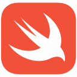
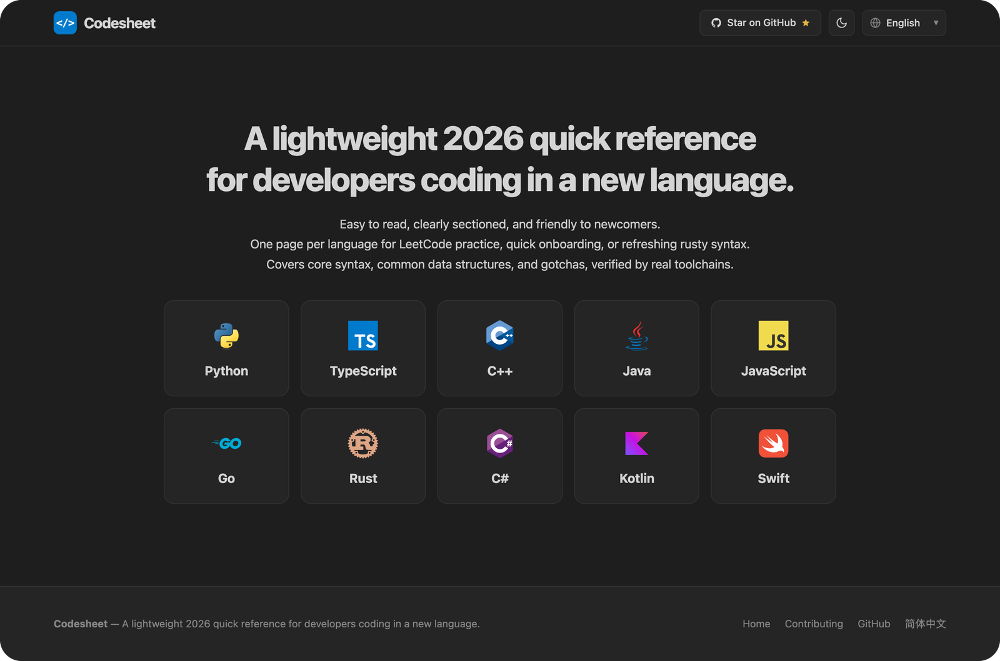

<div align="center">


# Codesheet

**2026 主流编程语言速查表，助你快速入门一门新编程语言。**

适合 LeetCode 刷题、快速入门，或重拾生疏的语法。<br>
涵盖核心语法、常用数据结构和常见陷阱，全部代码经过真实工具链验证。

[](https://github.com/Kepler2024/Codesheet/actions/workflows/check.yml)
[](#速查表)
[](#为什么选-codesheet)
[](CONTRIBUTING.zh-CN.md)
[](https://github.com/Kepler2024/Codesheet/stargazers)

<a href="sheets_zh/python.md"></a>&nbsp;
<a href="sheets_zh/java.md"></a>&nbsp;
<a href="sheets_zh/cpp.md"></a>&nbsp;
<a href="sheets_zh/javascript.md"></a>&nbsp;
<a href="sheets_zh/typescript.md"></a>&nbsp;
<a href="sheets_zh/csharp.md"></a>&nbsp;
<a href="sheets_zh/go.md"></a>&nbsp;
<a href="sheets_zh/kotlin.md"></a>&nbsp;
<a href="sheets_zh/swift.md"></a>&nbsp;
<a href="sheets_zh/rust.md"></a>

<p align="center">
  <a href="https://kepler2024.github.io/Codesheet/"></a>
</p>

**[在线阅读](https://kepler2024.github.io/Codesheet/)** · [浏览速查表](#速查表) · [参与贡献](CONTRIBUTING.zh-CN.md)

[English](README.md) | **简体中文**

</div>

---

## 猜猜输出

下面 5 段代码来自 5 门语言的速查表。你能猜对几个？

| 语言 | 代码 |
|---|---|
| JavaScript | `console.log([10, 9, 1].sort())` |
| Java | `Integer a = 127, b = 127;`<br>`Integer c = 1000, d = 1000;`<br>`System.out.println((a == b) + " " + (c == d));` |
| C++ | `vector<int> empty;`<br>`cout << empty.size() - 1 << endl;` |
| Kotlin | `println('a' + 1)` |
| Python | `bad = [[0] * 4] * 3`<br>`bad[0][0] = 1`<br>`print(bad)` |

<details>
<summary><b>查看答案</b></summary>
<br>

| 语言 | 输出 | 原因 |
|---|---|---|
| JavaScript | `[ 1, 10, 9 ]` | 不传比较函数时，`sort()` 会把数字当作字符串比较。[Arrays →](sheets_zh/javascript.md#数组) |
| Java | `true false` | 两个 `Integer` 用 `==` 比较的是引用。-128 到 127 之间的值有缓存，所以只在这个范围内看起来是对的。[Primitive and Boxed Types →](sheets_zh/java.md#基本类型与包装类型) |
| C++ | `18446744073709551615` | `size()` 返回无符号数，`0 - 1` 会回绕成一个极大的数，而不是 -1。[Arrays →](sheets_zh/cpp.md#数组与动态数组) |
| Kotlin | `b` | 与 Java 不同，Kotlin 中 `Char + Int` 的结果仍是 `Char`。[Strings →](sheets_zh/kotlin.md#字符串) |
| Python | `[[1, 0, 0, 0], [1, 0, 0, 0], [1, 0, 0, 0]]` | `* 3` 把同一个行对象重复了三次。[Arrays →](sheets_zh/python.md#数组与列表) |

每个 Pull Request 都会触发 CI，用真实工具链核对这些答案以及速查表中的其余示例。

</details>

## 为什么选 Codesheet

- **代码优先。** 速查表的主体是代码，注释用一两句话说明原因或提醒陷阱，没有大段说明文字。
- **算法题友好。** 内容覆盖用这门语言写 LeetCode 风格题解所需的知识，久未接触某门语言时也能随手翻查。
- **一套骨架，多门语言。** 每份速查表都有相同的 15 个章节，顺序一致。你可以把两份并排打开逐节对照，比如看 Java 和 Go 各自怎么用堆。个别语言需要多一节，例如 Rust 的 *Ownership and Borrowing*。
- **易错点标注。** 250 多条 `CAREFUL:` 注释指出这门语言与你熟悉的语言不同的地方。
- **示例可运行。** 检查器用固定版本的工具链编译运行近 300 个示例，把输出与注释逐项比对。速查表内容与实际行为不符时，CI 就会失败。

## 我为什么做这个项目

最初在 NeetCode 刷题时，我经常查阅作者 [@neetcode-gh](https://github.com/neetcode-gh) 编写的 Python 速查表。它在保持低阅读成本的同时，系统梳理了 Python 的核心语法与常用数据结构的用法。这种直观紧凑的形式不仅适合刷算法题，也非常适合有一定基础的开发者快速掌握一门新语言的骨架，或在久未接触某门语言时随时翻查常用写法。可惜它只覆盖 Python 一门语言。

于是我保留了这种形式，并在此基础上更进一步。Codesheet 覆盖十门语言，每份速查表都是同样的 15 个章节，换一门语言就像重读一页熟悉的内容，只是语法不同。CI 用固定版本的工具链编译运行每个示例，注释里写的每个输出都经过实际验证，而不是凭记忆写下的。`CAREFUL:` 注释专为转换语言的人而写，明确指出这门语言与你熟悉的语言有什么不同。所有速查表都同时提供中英文版本。希望它能给各位编程学习者带来方便。

## 速查表

| | 语言 | 适用版本 | 速查表 |
|:-:|---|---|---|
|  | Python | Python 3.14 | [中文版](sheets_zh/python.md) · [EN](sheets/python.md) |
|  | Java | Java 21 | [中文版](sheets_zh/java.md) · [EN](sheets/java.md) |
|  | C++ | C++23 (GCC 14) | [中文版](sheets_zh/cpp.md) · [EN](sheets/cpp.md) |
|  | JavaScript | Node.js 22 | [中文版](sheets_zh/javascript.md) · [EN](sheets/javascript.md) |
|  | TypeScript | TypeScript 5.7 on Node.js 22 | [中文版](sheets_zh/typescript.md) · [EN](sheets/typescript.md) |
|  | C# | C# 12 (.NET 8) | [中文版](sheets_zh/csharp.md) · [EN](sheets/csharp.md) |
|  | Go | Go 1.23 | [中文版](sheets_zh/go.md) · [EN](sheets/go.md) |
|  | Kotlin | Kotlin 2.1 | [中文版](sheets_zh/kotlin.md) · [EN](sheets/kotlin.md) |
|  | Swift | Swift 6.1 | [中文版](sheets_zh/swift.md) · [EN](sheets/swift.md) |
|  | Rust | Rust 1.93 | [中文版](sheets_zh/rust.md) · [EN](sheets/rust.md) |

所有速查表都按同一顺序展开：

> Running a Program → Variables → If-statements → Loops → Math → Output and Input → Arrays → Strings → Queues → HashSets → HashMaps → Tuples → Heaps → Functions → Classes

## 如何阅读速查表

```python
print(5 // 2)  # => 2

# CAREFUL: // rounds toward negative infinity; most languages truncate toward 0
print(-3 // 2)  # => -2
```

- `# => 2`（或 `// => 2`）表示这行代码的输出。循环的全部输出写在循环后的一条 `=>` 注释里。
- `CAREFUL:` 标出陷阱，即与多数语言行为不同的地方。
- 每份速查表标题下方注明了编写和测试时使用的工具链版本。

## 参与贡献

欢迎修正错误、改进示例或添加新语言。

1. 阅读[贡献指南](CONTRIBUTING.zh-CN.md)，以熟悉Codesheet文档规则。新速查表从 [TEMPLATE.zh-CN.md](TEMPLATE.zh-CN.md) 开始写。
2. 以 [sheets_zh/python.md](sheets_zh/python.md)（英文版 [sheets/python.md](sheets/python.md)）为参照把握覆盖范围和行文风格。
3. 运行 `python3 tools/check.py sheets/<id>.md`，通过后再提交 Pull Request。

添加新语言还需要为检查器编写适配器，详见[添加新语言](CONTRIBUTING.zh-CN.md#添加新语言)。

> 用 AI 编程助手写速查表？让它先读 [AGENTS.md](AGENTS.md)。AI 和人遵守同一套规则，也要通过同一个检查器。


## 致谢

本项目的灵感来自 NeetCode 的 [Python 速查表](https://neetcode.io/)。它用一页简短的代码示例讲清了许多常用写法。

## 许可证

[MIT](LICENSE)

